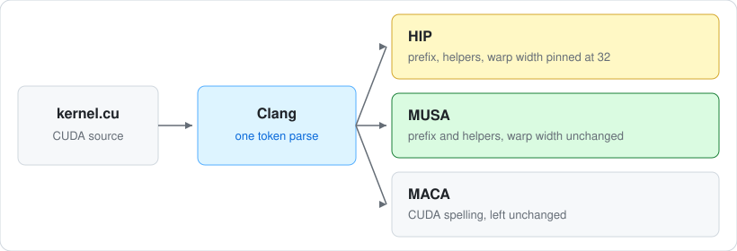

# cuda-retarget

Turn one CUDA file into HIP, MUSA, or the CUDA spelling MetaX compiles. The rewriter in this repository decides the edits. It does not call HIPIFY, musify, or cu-bridge, and it does not ship their source.

[](LICENSE)
[](#targets)
[](#quick-start)

[cuda-census](https://github.com/Tes-bo/cuda-census) runs the official toolchains and records their numbers. This repository does not score itself there.

<p align="center">
  
</p>

**Quick start · [What changes](#what-changes) · [Targets](#targets) · [Edges](#edges-the-helpers-match) · [Run](#run)**

A renamed `cudaMalloc` is source, not a binary. AMD's runtime, Moore Threads' runtime, MetaX's runtime, and each vendor's instruction set stay theirs. This project is not affiliated with NVIDIA, AMD, Hygon, Moore Threads, or MetaX.

## Quick start

Python 3.10 or newer. Clang must load `libclang` and see `cuda_runtime.h`. `LIBCLANG_PATH` and `CUDA_INCLUDE` override the defaults.

```bash
python3 -m cuda_retarget self-check
python3 -m cuda_retarget translate --target hip --input kernel.cu --output kernel.hip.cpp
python3 -m cuda_retarget translate --target musa --input kernel.cu --output kernel.mu
python3 -m cuda_retarget translate --target maca --input kernel.cu
```

Without `--output`, the translation goes to stdout. A parse failure or an unknown target exits 2.

## What changes

The sample the self-check translates:

```cuda
*out = __shfl_sync(0xffffffff, threadIdx.x, 0) + warpSize;
cudaMalloc(&p, sizeof(int));
```

HIP keeps CUDA's subgroup of 32 lanes. An omitted width would follow the device wavefront, and AMD's is 64.

```cpp
*out = __shfl_sync(0xffffffff, threadIdx.x, 0, 32) + 32;
hipMalloc(&p, sizeof(int));
```

MUSA keeps the 3-argument shuffle and `warpSize`. The documented warp there is 32 lanes. The runtime prefix still changes.

```cpp
*out = __shfl_sync(0xffffffff, threadIdx.x, 0) + warpSize;
musaMalloc(&p, sizeof(int));
```

MACA is the same text as the input. That compiler accepts CUDA, so an identity translation is the honest output.

Comments and string literals stay. A name inside a `#define` is rewritten at the definition. The `#define` name `warpSize` itself stays; a later use of it does not. `cudaFoo`, a user function with that prefix, is renamed on HIP and MUSA. `__shfl_sync`, `threadIdx`, and `atomicAdd` are not runtime identifiers.

## Targets

| `--target` | Names | Header | 32-lane warp | Integer and float helpers |
| --- | --- | --- | --- | --- |
| `hip` | `cudaMalloc` becomes `hipMalloc`, and the same prefix rule for every `cuda` identifier whose next character is uppercase. A `warpSize` use becomes `32` | `hip/hip_runtime.h` | a full-mask 3-argument shuffle gains `, 32`. Full-mask match, ballot, any, all, and uni become 32-lane helpers. `__syncwarp()` becomes `__syncwarp(0xffffffff)` | lowered |
| `musa` | the same rule with the `musa` prefix | `musa_runtime.h` | unchanged | lowered |
| `maca` | unchanged | `cuda_runtime.h` | unchanged | unchanged |

The helpers are bitcasts and double hi/lo words, funnel shifts, `__dp4a`, packed add/sub/min/max/abs, `__byte_perm`, averages, high-half products, absolute differences, packed absolute-difference sums, comparison masks, lane predicates, packed averages, bit scans, 24-bit products, rounding conversions, double-to-float rounding, float-to-half rounding, integer and double conversions into half, half-to-integer conversions, half add, multiply, fused multiply-add, packed half2 arithmetic, half comparisons, `__saturatef`, directed float add, sub, mul, and fused multiply-add, directed double add, sub, mul, and fused multiply-add, directed float division, reciprocal, square root, and reciprocal square root, and `fmin`/`fmax`, `nextafter`, and `copysign`, and `floor`, `ceil`, `trunc`, `rint`, `nearbyint`, and `round`, and `frexp`, `ilogb`, `modf`, `ldexp`, `fmod`, `remainder`, and `fdim`, and `lrint`, `lround`, `llrint`, and `llround`, and `hypotf`, `norm3df`, and `norm4df`, and `remquo` and `remquof`, and `logb`, `scalbn`, and `scalbln`, and `abs`, `labs`, `llabs`, `fabsf`, and `fabs`.

Inserted helpers are `static __device__` and sit after the last `#include`.

## Edges the helpers match

These are the results a prefix swap gets wrong. HIP and MUSA both get the helpers. Warp-width edits are HIP only.

| Call | Result |
| --- | --- |
| full-mask `__shfl_sync` / `xor` / `up` / `down` with 3 arguments, on HIP | `, 32` inserted. A width that is already present stays, including `warpSize` |
| `warpSize` use, on HIP | literal `32`. The name in `#define warpSize` stays |
| full-mask `__match_any_sync` / `__match_all_sync`, on HIP | a 32-lane mask. Float and double are compared by IEEE bits, so `-0` and `+0` differ |
| full-mask `__ballot_sync` / `__any_sync` / `__all_sync` / `__uni_sync`, on HIP | the same 32-lane subgroup. A predicate that is uniform in one warp stays uniform there |
| `__syncwarp()`, on HIP | `__syncwarp(0xffffffff)`. An explicit mask stays |
| `__vnegss2` of a `0x8000` lane | stays `0x8000`, the same bits as `__vneg2`. `__vnegss4` turns `0x80` into `0x7F` |
| `__vset*` | a true halfword writes `0x0001` and a true byte writes `0x01`. Failing lanes stay zero |
| `__vavgs2(1, 2)` and `__vavgs2(-2, -3)` | `2` and `-3`. Half rounds away from zero |
| `__vhaddu2(0xFFFF, 1)` | `0x8000`, not a wrapped `0` |
| `__hadd(INT_MIN, INT_MIN)` | `INT_MIN`. The average of `0xFFFFFFFF` and `1` is `2^31` |
| `INT_MIN * INT_MIN` through `__mulhi` | high half `2^30`, not a wrapped 32-bit product |
| `__sad` of `INT_MIN` | absolute value `2^31`. The following add wraps modulo `2^32` |
| `__vsad*` | the scalar sum of the lane differences. A `0x8000` lane contributes `32768` |
| `__vcmp*` | a true halfword is `0xFFFF` and a true byte is `0xFF` |
| `__float2int_rn(2.5f)` / `__float2int_ru(2.5f)` / `__float2int_rd(-2.5f)` | `2` / `3` / `-3`. Out-of-range values saturate |
| NaN to `__float2int_*` | `0` |
| NaN to `__float2ll_*` or `__float2ull_*` | the high bit |
| NaN to `__double2int_*` | `0x80000000`, in every rounding mode |
| `__double2float_rn(1+2^-24)` / `__double2float_ru` of that tie | stays on 1 / the next float. Toward zero, a value past the finite maximum stays finite |
| a double NaN passed to `__double2float_*` | a quiet float NaN with the same sign. `-0` stays `-0` |
| `__float2half_rn(1+2^-11)` / `__float2half_ru` of that tie | `15360` / `15361`. `__float2half` matches the nearest-even form |
| `__float2half_rz` of a value past 65504 | `31743`, the finite maximum. Round-up is infinity `31744` |
| a NaN passed to `__float2half_*` | `32767`, and the sign is dropped. `__half2float` of that NaN is `2147483647` |
| `-0` through `__float2half_rd` | `32768` |
| `__int2half_rn(2049)` / `__int2half_ru(2049)` / `__int2half_rd(-2049)` | `26624` / `26625` / `59393` |
| `__int2half_rn(65520)` / `__int2half_rz(65520)` | infinity `31744` / the finite maximum `31743` |
| `__int2half_rn(-65519)` / `__int2half_rd(-65520)` | `64511` / `64512` |
| `__double2half` of the double just above `2^-25` | `1`. Casting that double to float first gives `0` |
| a double NaN passed to `__double2half` | `32767`. `-0` stays `32768` |
| `__half2int_rn` of 1.5 / `__half2int_rz` / `__half2int_ru` | `2` / `1` / `2`. The nearest-even half of 0.5 stays `0` |
| `__half2short_rn` of 32768 | `32767`. The 32-bit conversion stays `32768` |
| `__half2short_rn` of -65504 | `-32768`. The unsigned conversion is `0` |
| a half NaN passed to `__half2int_*` / `__half2ll_*` | `0` / the high bit `9223372036854775808` |
| `+inf` passed to `__half2ushort_*` | `65535` |
| `__hadd(+0, -0)` / `__hadd(-0, -0)` | `+0` / `-0`. `__hadd_rn` matches `__hadd` |
| a NaN operand of `__hadd` | `32767`. The sign and payload are dropped |
| `__hfma` of `(1+2^-10)` squared minus the rounded square | `16` (`2^-20`). The separate product plus that square cancels to `0` |
| `__hadd_sat` of a NaN, of `-0`, or of a value above 1 | `+0`, `+0`, or `1` |
| `__hadd2` with a NaN in the low lane and `1+1` in the high lane | low `32767`, high `16384`, packed word `1073774591` |
| `__hfma2` low lane of `(1+2^-10)` squared minus its rounded square | packed word `16`. The high lane can be `0` |
| `__floats2half2_rn(1+2^-11, 65520)` | low lane `1`, high lane `+inf`, packed word `2080390144` |
| `__hne` / `__hneu` of a NaN | `0` / `1`. Ordered not-equal is false |
| `__heq2` true lane / `__heq2_mask` true lane | `15360` (`1.0`) / `65535` |
| `__hmax(+0, -0)` / `__hmin(+0, -0)` | `+0` / `-0`. A NaN loses to a number. Two NaNs are `32767` |
| `__hneg` of a NaN, or of `-0` | `32767`, or `+0` |
| `__saturatef` of a NaN or of `-0` | `+0`. Values outside `[0, 1]` clamp |
| `__fadd_ru` of 1 and a value below one ulp | the next float above 1. The nearest-even tie stays on the even float |
| `__fadd_rd(+0, -0)` / `__fadd_rd(+0, +0)` | `-0` / `+0`. Same-sign zeros keep their sign |
| `__fadd_rz` of two overflowing magnitudes | the finite maximum, not infinity |
| `__fmaf_rn` of `(1+2^-23)` squared minus the rounded square | `2^-46` (`679477248`), not 0 |
| a NaN operand of `__fadd_*` or `__fmaf_*` | the canonical quiet NaN `2147483647` |
| `__dadd_ru` of 1 and `2^-53` | the next double above 1. The nearest-even tie stays on 1 |
| `__dadd_rd(+0, -0)` / `__dadd_rd(+0, +0)` | `-0` / `+0`. Same-sign zeros keep their sign |
| `__dadd_rz` of two overflowing magnitudes | the finite maximum `9218868437227405311`, not infinity |
| the second NaN operand of `__dadd_rn` | that NaN, quieted. `__dsub_rn` keeps its sign |
| `__dmul_rn(+inf, +0)` | the negative quiet NaN `18444492273895866368` |
| `__fma_rn` of `(1+2^-52)` squared minus the rounded square | `2^-104` (`4138808057553485824`), not 0 |
| `__dsub_rd` of 1 and `2^-53` | the double just below 1, `4607182418800017407` |
| `__fdiv_rn(+0, -0)` / `__fdiv_rn(1, +0)` | the canonical NaN `2147483647` / `+inf` |
| `__fsqrt_rn(-0)` / `__fsqrt_rn` of a negative | `-0` / the canonical NaN `2147483647` |
| `__fsqrt_ru(2)` | one float above `__fsqrt_rn(2)` |
| `__fdiv_rz(1, 3)` | one float below the nearest-even quotient |
| `__fdiv_ru` of the smallest subnormal over the finite maximum | `1`. The other modes stay `0` |
| `__fdiv_rd` of an overflowing positive quotient | the finite maximum `2139095039` |
| `__frsqrt_rn` of the normal `0x187fffff` | `1392508928`. The reciprocal of the rounded square root is `1392508929` |
| `__frsqrt_rn(-0)` | `-inf` |
| `__ddiv_rz` / `__ddiv_rd` of an overflowing positive quotient | the finite maximum `9218868437227405311` |
| `__ddiv_ru` of a quotient that underflows to the bottom | `1`. `__ddiv_rn` gives `0` |
| `__ddiv_rz/ru/rd` of two NaNs | the first operand, quieted. `__ddiv_rn` keeps the second |
| `fminf(+0, -0)` / `fmaxf(+0, -0)` | `-0` / `+0`. `fmaxf(-0, -0)` stays `-0` |
| two float NaNs passed to `fminf` | the canonical quiet NaN `2147483647`. A number wins over one NaN |
| `nextafterf(+0, -0)` | `-0`. `nextafterf(+0, +inf)` is the smallest subnormal |
| `nextafterf` of a NaN | the canonical quiet NaN `2147483647` |
| two double NaNs passed to `fmin` or `nextafter` | the second NaN, quieted (`9221120237041090565` for payloads 1 then 5) |
| `copysignf` of NaN payload `0x7fc00001` and `-0` | `4290772993`. The payload stays |
| `__mul24` | the high 8 bits are ignored. The square of the minimum 24-bit value keeps a low half of `0` |
| `__clz(0)` / `__clzll(0)` / `__ffs(0)` | `32` / `64` / `0` |
| `__dp4a` of a `0x80` byte | `-128` signed, `128` unsigned |
| `__byte_perm` | four bytes from `y:x`. Selector bits above bit 15 are ignored |
| `__funnelshift_l` / `_r` | `shift & 31`. The clamp forms stop at 32 |
| `__ll2double_rn` of `2^53+1` | `4845873199050653696`. Round-up is the next double |
| `__ll2double_rn` of `2^53+3` | the next even double `4845873199050653698`. Toward zero stays one below |
| `__ll2double_rd` of `-(2^53+1)` | one double below the nearest-even value, `14069245235905429505` |
| `__ull2double_rz` of the maximum unsigned value | `4895412794951729151`. Round-up reaches `2^64` |
| `__int2double_rn(INT_MIN)` | the exact double `13970166044103278592` |
| `lop3.b32` immediate `0xF0` / `0xCC` / `0xAA` | the first, second, or third operand |
| `lop3.b32` of `1, 2, 4` with immediate `0x80` | `0`. Only a bit set in all three inputs is kept |
| `bfe.s32` of bit 0 of `1`, length 1 | all ones. `bfe.u32` of the same field is `1` |
| `bfe.s32` with a start at bit 32 | all ones when bit 31 is set, otherwise `0`. `bfe.u32` is `0`. A length of 0 is `0` |
| `bfi.b32` with a start at bit 32 | the base, unchanged |
| `prmt.b32` selector nibble `0x8` | `0` or `0xFF` from that byte's sign. `__byte_perm` copies the byte |
| `rintf(0.5)` / `roundf(0.5)` | `+0` / `1`. `nearbyintf(0.5)` matches `rintf` |
| `rintf(2.5)` / `roundf(2.5)` | `2` / `3`. `rintf(-2.5)` is `-2` and `roundf(-2.5)` is `-3` |
| `floorf` of a negative subnormal | `-1`. `truncf` and `ceilf` of it are `-0` |
| a float NaN passed to `floorf` | the canonical quiet NaN `2147483647` |
| a signaling double NaN passed to `floor` | the same payload, quieted, `9221120237041090561` |
| `frexpf` of the smallest subnormal | `0.5` with exponent `-148`. `ilogbf(0)` is `INT_MIN` and infinity is `INT_MAX` |
| `ldexpf(1, -150)` | `+0`. One bit above that power is the smallest subnormal |
| `remainderf(7, 2)` / `fmodf(7, 2)` | `-1` / `1` |
| `fdimf` of two infinities with the same sign | `+0`. Opposite signs stay infinite |
| `fmod(1, 0)` | the negative quiet NaN `18444492273895866368` |
| `lrintf(0.5)` / `lroundf(0.5)` | `0` / `1`. `lroundf(-0.5)` is `-1` |
| `lrintf(2.5)` / `lroundf(2.5)` | `2` / `3`. `lroundf(-2.5)` is `-3` |
| `lrintf` of `2^31` | `2147483648` |
| a float NaN passed to `lrintf` | `LLONG_MIN` |
| `lrint` of `2^51 + 0.5` / `lround` of it | `2251799813685248` / `2251799813685249` |
| `lrint` of `2^63` / `-2^63` | `LLONG_MAX` / `LLONG_MIN` |
| `hypotf(+inf, NaN)` | `+inf`. A finite NaN argument becomes the canonical quiet NaN |
| `hypotf(2^64, 2^64)` | `1605698803`. The square of `2^64` overflows before a square root |
| `norm4df` of four `2^64` values | `2^65` |
| `norm3df(+inf, NaN, NaN)` | `+inf` |
| `remquof(7, 2)` | remainder `-1`, quotient `4` |
| `remquof(15, 2)` | remainder `-1`, quotient `0`. The rounded quotient is `8` |
| `remquof(15, 1)` | quotient `7`. The integer quotient is `15` |
| `remquof(2^23 + 1, 2)` | remainder `1`, quotient `0` |
| an invalid `remquof` | the canonical quiet NaN, and the quotient is written as `0` |
| `remquo(1, 0)` | the negative quiet NaN `18444492273895866368`, quotient `0` |
| `logbf(0)` and `logbf(-0)` | `-inf`, bits `4286578688` |
| `logbf(+inf)` and `logbf(-inf)` | `+inf` |
| `logbf` of the smallest subnormal | `-149`, bits `3272933376` |
| a float NaN passed to `logbf` | the canonical quiet NaN `2147483647` |
| `scalbnf(-0, 4)` | `-0` |
| `scalbnf(0.5, -126)` | `2^-127`, bits `4194304` |
| `scalblnf(1, 2^31)` | `+inf`. The exponent is a 64-bit `long` |
| a signaling double NaN passed to `logb` | the same payload, quieted, `9221120237041090561` |
| `abs(INT_MIN)` | `INT_MIN`, `-2147483648` |
| `abs` of `INT_MIN` widened to `long` | `2147483648` |
| `llabs(LLONG_MIN)` | `LLONG_MIN` |
| `fabsf` of a NaN | the canonical quiet NaN `2147483647`. `fabsf(-0)` is `+0` |
| `fabs` of a negative double NaN | the sign and payload stay. A signaling NaN is quieted, `18444492273895866369` |

Signed lane `0x8000` and unsigned lane `0x8000` are different numbers in the packed comparisons, min/max, and absolute differences.

## What stays source

A later vendor compile may reject these, or give them a different meaning:

- Inline PTX other than one `lop3.b32`, `bfe.u32`, `bfe.s32`, `bfi.b32`, or `prmt.b32` with a single `=r` output and `r` inputs. A second instruction, a predicate, a clobber list, or a different constraint stays source.
- A shuffle that already has a width argument. That literal is kept.
- A `__syncwarp` call that already passes a mask.
- A 3-argument shuffle, a match call, or a vote call whose mask is not the literal `0xffffffff` (`u`, `l`, `ll`, or `ull`). A variable mask is still CUDA's width 32 on NVIDIA and the wavefront width on AMD. This rewriter does not guess which mask the programmer meant.
- `lane & 31` and any other width arithmetic.
- The 5-argument CUDA Graph instantiate call. It is renamed, and its arguments stay. The `0` there is a buffer size, not flags.
- `hypot`, `rhypot`, `norm3d`, and `norm4d`, and the reciprocal forms `rhypotf`, `rnorm3df`, and `rnorm4df`. nvcc lowers those with `rsqrt.approx`.

## Run

```bash
python3 -m unittest discover -s tests -v
```

The tests do not compile HIP or MUSA output with `nvcc`. When `nvcc` is on `PATH` and a GPU is free, they compile the helper text and compare it with the CUDA intrinsic.

## License

Apache License 2.0. See `LICENSE` and `NOTICE`.
